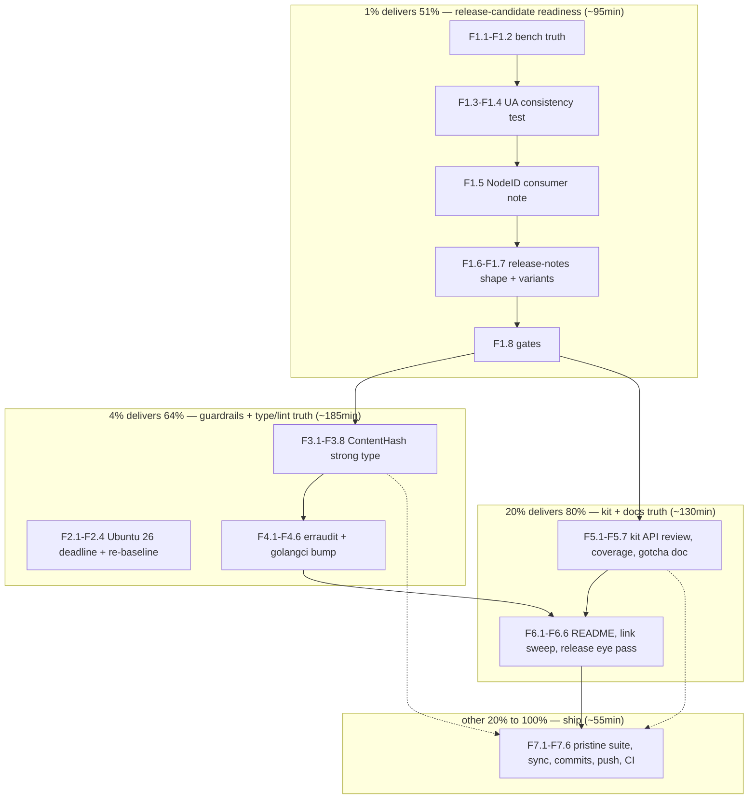

# SUPERB Execution Plan — Release readiness + type-safety + kit completion (all open TODOs, zero owner-gate prep left behind)

- **Date:** 2026-10-15 07:23 CEST (via `date`)
- **Input:** `TODO_LIST.md` (18 open rows: 2 High, 9 Medium, 7 Low), ROADMAP raw ideas
  (Themes 1-4), the 2026-10-15 status report §f follow-ups (Ubuntu 26 deadline,
  bench sanity, link sweep), and the three 10-15 status reports' open items.
  ALL open TODOs are included and routed below.
- **Context:** Four sessions of shipped work (BDD kit, `NodeID` sweep, the
  dead-allocation fix, the CI repair) are sitting unreleased on master behind
  ONE owner word. The Ubuntu 26 runner migration lands 2026-10-19 (4 days).
  The lint story has a version-skew risk (local v2.14.0 vs CI v2.13.2). The
  BD003 arc has one known blind spot (`ContentHash`). This plan executes every
  ungated TODO and reduces every owner-gated TODO to a single-word decision.
- **Scope discipline:** Additive hardening and docs only. NO new dependencies,
  NO experiment-gated stdlib, NO wire-contract changes, NO seam implementation,
  NO external-repo pushes, NO tag/release execution (owner-gated; this plan
  only stages it). Deterministic outputs pinned by goldens MUST stay
  byte-identical.

---

## 1. Pareto Breakdown

### The 1% that delivers 51% — RELEASE-CANDIDATE READINESS (M1)

Four sessions of work are unreleased. The owner's only remaining act is
choosing `v0.3.3` or `v0.4.0`; everything that could delay that word — bench
truth post-`NodeID`, the UA↔CHANGELOG consistency test so the release cannot
ship with a stale UA stamp, the consumer migration note, release-notes-shaped
CHANGELOG — gets done NOW. Everything else in this plan is worth less, because
unreleased work delivers nothing to consumers and every pending consumer
decision (bdd require-sync, tag timing, CV bump) queues behind this cut.

- M1 (F1.1–F1.10).

### The 4% that delivers 64% — trust + guardrails + type truth (M2 + M3 + M4)

One deadline-critical CI risk (Ubuntu 26 forced migration, 2026-10-19), one
type-safety gap with a named blind spot (`ContentHash` for cache keys), and
one lint-truth batch (the recurring `errors.As` finding + the local/CI
golangci version skew). All cheap, local, provable; all remove standing
"known-issue" tax.

- M2 (F2.1–F2.4), M3 (F3.1–F3.8), M4 (F4.1–F4.6).

### The 20% that delivers 80% — kit completion + docs truth (M5 + M6)

The kit is one API review away from freezable, three exported helpers may be
spec-uncovered, and consumers will hit the Ginkgo typed-entries panic without
a doc line. The README undersells two shipped features and still carries the
post-tag install caveat wording; the archived plan moved and needs a link
sweep.

- M5 (F5.1–F5.7), M6 (F6.1–F6.6).

### The other 20% to reach 100% — ship + owner-gated enumeration (M7 + §5)

Strictly-last ship block (pristine suite, truth sync, per-concern commits,
push through the three-gate hook, CI watch), then EVERY remaining TODO is
enumerated in §5 with its recorded gate so the owner's board is exactly
eleven one-line decisions.

- M7 (F7.1–F7.6), §5.

---

## 2. Comprehensive Plan (medium granularity, 30–100min per task)

Sorted by importance / impact / effort / customer-value.

| #  | Task                                                                                                                                                                  | Impact   | Effort | Customer value                                                                      | Depends on |
| -- | --------------------------------------------------------------------------------------------------------------------------------------------------------------------- | -------- | ------ | ----------------------------------------------------------------------------------- | ---------- |
| M1 | Release-candidate readiness: bench sanity + benchstat re-record, UA↔CHANGELOG consistency test, "Upgrading to NodeID" consumer note, CHANGELOG release-notes shape    | Critical | 95min  | The owner's cut decision becomes one word; consumers get a migration path           | —          |
| M2 | CI runner migration test (Ubuntu 26, deadline 2026-10-19) + buildflow re-baseline (agent-config self-resolve)                                                         | High     | 40min  | No surprise red CI from the forced runner migration                                 | —          |
| M3 | `ContentHash` strong type for embedding-cache keys (BD003 blind spot: `HashText` output, cache-entry keys, Store cache-column boundary)                               | High     | 90min  | Completes the strong-typing arc; cache keys can no longer be confused with raw text | —          |
| M4 | Lint truth: `errors.As`→`AsType` (`embed_openai.go:334`, re-check `embed_openai_test.go:249`) + golangci bump v2.13.2→v2.14.x WITH CV parity + CI-parity verification | High     | 55min  | Zero standing lint findings; local/CI lint skew risk eliminated                     | —          |
| M5 | Kit completion: `Harness.Search` API review decision, spec-coverage audit (`WeightedEdge`/`WithKind`/`SimilarEdgeScore`), Ginkgo typed-entries gotcha in `bdd/doc.go` | Med-High | 80min  | Kit becomes freezable for its first tag; consumers skip a known panic               | —          |
| M6 | Docs truth close-out: README `EmbedConcurrency` + bdd install-caveat wording, archived-plan link sweep, GitHub Release body human-eye pass                            | Med      | 50min  | Public face matches reality; no dangling links to the archived plan                 | M1         |
| M7 | Ship: full pristine suite + `-race`, TODO_LIST/CHANGELOG sync, per-concern commits, push (three-gate hook), CI watch                                                  | Critical | 45min  | Remote truth = local truth                                                          | all        |

**Total: ~7.6h.** M1 first (the 1%), M2 immediately after (deadline), M3/M4
interleave, M5/M6 next, M7 strictly last.

---

## 3. Detailed Breakdown (fine granularity, ≤12min per task)

Sorted by importance / impact / effort / customer-value within the medium-task
ordering.

| #    | Task (atomic, ≤12min)                                                                                                                                                                           | Impact   | Effort | Verify                                                               |
| ---- | ----------------------------------------------------------------------------------------------------------------------------------------------------------------------------------------------- | -------- | ------ | -------------------------------------------------------------------- |
| F1.1 | Bench sanity: `go test -bench 'Build\|SimilarPairs\|StoreRoundTrip' -benchtime 100ms` — confirm `NodeID` map-key typing is perf-neutral                                                         | High     | 10min  | numbers within noise of the doc-comment table                        |
| F1.2 | Full benchstat re-record (`-count 10`) IF F1.1 moves; else record "sanity-passed 2026-10-15" in the bench doc comment                                                                           | Med      | 12min  | bench_test.go doc comment carries a dated line                       |
| F1.3 | UA↔CHANGELOG consistency test: parse the newest `## [x.y.z]` section from CHANGELOG.md, assert minor matches `UserAgentVersion` (asserts consistency, never a hardcoded value)                  | High     | 12min  | `go test -run UserAgent` ok; break UA → test fails                   |
| F1.4 | Same test under the pristine build (no experiment tags) — it must pass both ways                                                                                                                | Med      | 5min   | `env -u GOEXPERIMENT go test -run UserAgent` ok                      |
| F1.5 | Write "Upgrading to NodeID" consumer note (`docs/upgrading.md` or README section): the one affected pattern (`string` variables), the one-line fix (`graphrag.NodeID(...)`), wire-shape promise | Med      | 12min  | dprint clean; link from CHANGELOG migration paragraph                |
| F1.6 | CHANGELOG release-notes shape: confirm `[Unreleased]` sections (Added/Changed/Fixed) extract cleanly the way `release.yml`'s substring matcher expects                                          | Med      | 8min   | mentally trace release.yml extraction against the headers            |
| F1.7 | Draft BOTH release-note variants (v0.3.3 fixes-only / v0.4.0 bundled) as a comment block for the owner — one word decides                                                                       | Med      | 10min  | variants present in the plan's §5 or a scratch note                  |
| F1.8 | Gates: build/vet/test pristine                                                                                                                                                                  | High     | 5min   | all green                                                            |
| F2.1 | Read the Ubuntu 26 migration annotation on the last CI run; identify the workflow changes (if any) needed                                                                                       | High     | 8min   | migration requirements noted or deemed no-op                         |
| F2.2 | Trigger a workflow dispatch / test run if the migration allows pre-testing; else document the 10-19 watch step in AGENTS gotchas                                                                | High     | 12min  | CI green on the new runner OR documented watch step                  |
| F2.3 | Run buildflow; expect `agent-config` GONE (AGENTS.md now fresh) + the two known owner-gated securitymd errors + erraudit (until M4)                                                             | Med      | 10min  | no NEW findings vs the documented mix                                |
| F2.4 | Re-baseline note: update the AGENTS buildflow-gotcha mix if the findings changed                                                                                                                | Low      | 5min   | AGENTS matches reality                                               |
| F3.1 | Design `ContentHash`: defined string type; surfaces = `HashText` return, cache-entry keys, `Store` cache-column boundary; decide wire exposure (NONE — internal only)                           | High     | 12min  | design note in the type's doc comment                                |
| F3.2 | Implement `ContentHash` in `vector.go` (`HashText` returns it) + migrate `build.go`/`store.go` internals                                                                                        | High     | 12min  | `go build ./...` ok                                                  |
| F3.3 | Migrate remaining call sites + tests; untyped literals still assign (document, mirroring the `NodeID` contract)                                                                                 | High     | 12min  | `go vet` + `go test` ok                                              |
| F3.4 | brandid-lint: `brandid-lint -rules BD001,BD003 .` exits 0 (no new findings; `Hash`-named surfaces were BD003's blind spot — now typed by hand)                                                  | Med      | 5min   | exit 0                                                               |
| F3.5 | Wire goldens + godoc examples unchanged (hash is internal; JSON shapes untouched) — run the golden + example tests                                                                              | Critical | 8min   | `go test -run 'WireGolden\|Example'` ok                              |
| F3.6 | `go test ./... -race` (hot-path map keys touched)                                                                                                                                               | Critical | 10min  | race clean                                                           |
| F3.7 | bdd module untouched (no exported change) — confirm `bdd/go.mod`/specs compile against the sibling checkout                                                                                     | Med      | 5min   | `(cd bdd && go test ./...)` ok                                       |
| F3.8 | CHANGELOG [Unreleased] Changed entry + FEATURES row for `ContentHash` (type-system inventory)                                                                                                   | Med      | 8min   | entries present, dprint clean                                        |
| F4.1 | `errors.As`→`errors.AsType` at `embed_openai.go:334` (`isRetryableEmbeddingErr`)                                                                                                                | Med      | 8min   | build + tests ok; erraudit finding gone                              |
| F4.2 | Re-check `embed_openai_test.go:249` (`errors.Is`, sentinel-correct today): migrate only if the modernization rule says so; record the verdict                                                   | Low      | 8min   | verdict noted (migrate or keep)                                      |
| F4.3 | golangci-lint v2.13.2→v2.14.x: bump the CI workflow pin + local toolchain; consult CV's pin FIRST (bump-together rule)                                                                          | High     | 12min  | both repos' pins aligned; lint green locally                         |
| F4.4 | CV-side: check CV's golangci pin; if CV bumps in its own session, record the coordination note in AGENTS.md (both-repos rule)                                                                   | Med      | 8min   | AGENTS pin rule reflects reality                                     |
| F4.5 | Run the FULL lint suite over both modules with the new version; fix or triage every new finding                                                                                                 | High     | 12min  | 0 issues both modules (or triaged with nolint + reason)              |
| F4.6 | erraudit + buildflow re-run: erraudit root finding GONE; record the new buildflow mix in AGENTS if changed                                                                                      | Med      | 8min   | buildflow mix updated                                                |
| F5.1 | `Harness.Search` API review: variadic `...SearchOptions` (first-wins) vs `(ctx, query, opts...)` idiomatic — write the decision + rationale                                                     | High     | 12min  | decision recorded in the bdd ADR (annotate or amend per its §-rules) |
| F5.2 | If the review demands a change: implement + migrate 43 specs; if freeze: record "frozen for v0.1.0" in the ADR                                                                                  | High     | 12min  | specs green either way                                               |
| F5.3 | Spec-coverage audit: grep specs for direct `WeightedEdge`/`WithKind`/`SimilarEdgeScore` use; list uncovered helpers                                                                             | Med      | 10min  | coverage list written                                                |
| F5.4 | Add minimal specs for uncovered helpers (rank-pinned where deterministic)                                                                                                                       | Med      | 12min  | new specs pass; suite count recorded                                 |
| F5.5 | Document the Ginkgo typed-`DescribeTable` gotcha in `bdd/doc.go` (string literals panic via reflect once params are named types)                                                                | Med      | 10min  | godoc renders; dprint clean                                          |
| F5.6 | `golangci-lint` + `gofumpt` pass over touched bdd files; `-race` suite re-run                                                                                                                   | Med      | 10min  | 0 issues; race clean                                                 |
| F5.7 | Record kit-suite spec count wherever the README/ADR claims it (43 → new count)                                                                                                                  | Low      | 5min   | counts match                                                         |
| F6.1 | README: mention `EmbedConcurrency` in the providers section (network-bound cold builds, default 1)                                                                                              | Med      | 8min   | dprint clean                                                         |
| F6.2 | README: soften the bdd install caveat wording to "first `bdd/v*` tag pending (owner-gated)" — still true, better toned                                                                          | Low      | 5min   | wording accurate                                                     |
| F6.3 | Archived-plan link sweep: grep the repo for the old `planning/2026-09-19_15-39` path; fix any live reference to the `archived/` location                                                        | Med      | 8min   | zero references to the old path                                      |
| F6.4 | GitHub Release body human-eye pass on v0.3.0/v0.3.1/v0.3.2 releases page (18-00 f25): rendering + notes correctness                                                                             | Low      | 10min  | verdicts noted (no action / fix)                                     |
| F6.5 | ROADMAP: mark the "explicit JSON round-trip v1-vs-v2 test" idea as spec'd (still raw; no action) — skip unless trivial                                                                          | Low      | 5min   | ROADMAP unchanged or minimally annotated                             |
| F6.6 | Full docs lint: `dprint check` repo-wide + link-existence spot sweep over this plan's own cross-references                                                                                      | Med      | 5min   | dprint clean; links resolve                                          |
| F7.1 | Full pristine suite: `env -u GOEXPERIMENT GOTOOLCHAIN=go1.27.1` build/vet/test, `-race -count=1`, both modules                                                                                  | Critical | 12min  | ALL GREEN                                                            |
| F7.2 | golangci-lint (new version) both modules + tidy drift both modules + dprint + brandid-lint                                                                                                      | Critical | 10min  | ALL GREEN                                                            |
| F7.3 | TODO_LIST sync: delete done rows (UA test, benchstat re-run, spec-coverage audit, NodeID note, EmbedConcurrency README, erraudit, golangci bump, ContentHash, Ginkgo doc); keep BLOCKED rows    | High     | 10min  | list reflects truth                                                  |
| F7.4 | Per-concern detailed commits (release-readiness / type-safety / lint-truth / kit / docs / ship) — explicit paths, `git status` re-check in the SAME command (daemon races)                      | Critical | 12min  | history tells the story                                              |
| F7.5 | Push (three-gate pre-push hook runs) + watch `go-test` to green on the new HEAD                                                                                                                 | Critical | 10min  | CI green                                                             |
| F7.6 | Close-out: report against this plan's §8 definition of done; deviations recorded honestly                                                                                                       | Med      | 8min   | DoD table filled                                                     |

**46 fine tasks.** Every task ends on its verify gate — no task is done
without its check passing.

---

## 4. Execution Graph

Order within T2/T3 is preference, not dependency; every task ends on its
verify gate. M7 runs strictly last. F2.1/F2.2 jump the queue if the runner
migration announcement requires action before 2026-10-19.

---

## 5. Explicitly deferred / owner-gated (enumerated so NOTHING is lost)

Not executed in this plan; each has a recorded gate or decision:

1. **Q1 license posture** — BLOCKED on owner (TODO_LIST High); gates public
   godoc + CONTRIBUTING inbound grant; the archive sweep of Q1-gated status
   reports unblocks the moment it lands.
2. **The version word: `v0.3.3` vs `v0.4.0`** — owner; F1.7 stages both
   variants so the decision is one word. Includes the bench-table re-measure
   question (F1.1/F1.2 make either answer safe).
3. **`bdd/v0.1.0` tag + `release.yml` `bdd/v*` trigger** — owner; M5 removes
   the API-review prerequisite; require-sync is a 5-minute step once the core
   tag exists.
4. **SECURITY.md contact channel + practices section** — owner (buildflow
   securitymd 2 findings; TODO_LIST Medium).
5. **Live-endpoint smoke test** — BLOCKED on `GRAPHRAG_LIVE_EMBED_*` creds
   (TODO_LIST Medium).
6. **qmd#959/crush#3846 send-or-drop** — held past 2026-09-22 by owner
   ruling; patches live in the issue texts (TODO_LIST Medium watch row).
7. **CONTRIBUTING inbound-grant line** — queues behind Q1 (TODO_LIST Medium).
8. **metaengine dep-tree quantification** — owner "run soon" item
   (TODO_LIST Medium; feeds any adapter-cost question).
9. **`brandid-lint` promotion to pre-push/CI** — owner decision + planted-
   failure drills (TODO_LIST Low; F3.4 keeps the local gate green meanwhile).
10. **Git Town config ruling** — disable WIP-stash for daemon-committed repos
    vs keep the AGENTS gotcha as mitigation (new; from the 2026-10-15 wipe).
11. **CV-side bump (owner package Phase 8)** — external repo; consumes the
    cut from item 2; `NodeID` conversion at `graphvocab`/service/config
    touchpoints.

---

## 6. VERSCHLIMMBESSER Guards (how we do NOT break the system)

1. **Determinism is load-bearing.** `ContentHash` is INTERNAL: no JSON shape,
   golden, or rendered output may change. F3.5 pins this before anything else
   touches the type. Success-path outputs byte-identical or the task failed.
2. **No new dependencies.** `ContentHash` is a defined type over stdlib;
   the UA test parses CHANGELOG with stdlib. Core `go.mod` must diff to
   +0 lines.
3. **No experiment-gated stdlib.** Every Go-touching task ends in the
   pristine build; F4's golangci bump must keep the config buildable without
   experiments.
4. **The UA test asserts CONSISTENCY, not a value** — a hardcoded `0.3`
   assertion would break every future release (the exact remembered-step
   trap it exists to kill).
5. **No tag, no release, no external push in this plan.** M1 stages the
   decision; the cut itself stays owner-gated (§5 items 2-3).
6. **bdd API changes only if the review DEMANDS them**, and then with all 43
   specs migrated and green in the same task — never left half-migrated.
7. **External repos: edit, don't commit, don't push** (CV pin consultation in
   F4.4 is read-only).
8. **Nothing pushes that isn't gate-green** (F7.1-F7.2 before F7.5); if CI is
   red after push: stop, read logs, fix root cause — never force.
9. **Research/planning docs are annotate-only** — execution status goes to
   `docs/status/` at close, never by rewriting history.
10. **Git Town watch**: after every commit batch, `git status` must show a
    clean-or-expected tree; any vanishing file goes to `git fsck --lost-found`
    recovery immediately (2026-10-15 incident protocol).

---

## 7. TODO_LIST routing note

The plan consumes the TODO/ungated rows: UA test, benchstat re-run, Ginkgo
doc, spec-coverage audit, NodeID note, EmbedConcurrency README, erraudit,
golangci bump, `ContentHash` — completed rows are deleted at F7.3 per the
TODO lifecycle. BLOCKED rows (Q1, release decision, bdd tag, SECURITY channel,
live smoke, CONTRIBUTING, metaengine, brandid gate) stay untouched and are
enumerated in §5. Two NEW items surface here and land in TODO_LIST with this
plan: the Ubuntu 26 runner test (Medium, deadline 2026-10-19) and the bench
sanity pass (folded into the benchstat row's evidence).

---

## 8. Definition of done for this plan

- Bench truth exists: sanity pass recorded (and benchstat re-record IF numbers
  moved); `bench_test.go` doc comment carries a dated 2026-10-15 line.
- A UA↔CHANGELOG consistency test exists, passes pristine, and fails on a
  stale `UserAgentVersion` (consistency assertion, not a value assertion).
- "Upgrading to NodeID" consumer note exists and is linked from the CHANGELOG
  migration paragraph; both release-note variants are staged for the owner.
- Ubuntu 26 runner position is known: tested green OR a documented watch step
  before 2026-10-19; buildflow mix re-baselined in AGENTS.md.
- `ContentHash` ships: `HashText`/cache keys typed, wire goldens + godoc
  examples byte-identical, `-race` clean, brandid-lint exit 0, CHANGELOG +
  FEATURES updated.
- erraudit root finding gone (`AsType` at `embed_openai.go:334`; recorded
  verdict for the test-side `errors.Is`); golangci bumped WITH CV parity, both
  modules lint 0 issues, AGENTS pin rule accurate.
- Kit: API-review decision recorded in the bdd ADR; spec-coverage audit done
  with gaps closed; typed-`DescribeTable` gotcha documented in `bdd/doc.go`.
- README names `EmbedConcurrency` and the bdd caveat is accurately worded;
  zero references to the archived plan's old path; release bodies eye-passed.
- Pristine full suite + `-race` ALL GREEN; TODO_LIST/CHANGELOG truth-synced;
  per-concern commits pushed; `go-test` green on the new HEAD.
