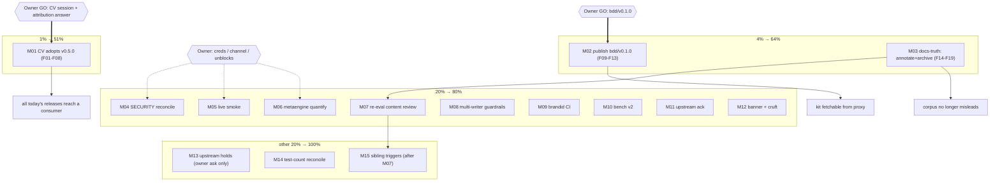

# SUPERB — Pareto Execution Plan (post-v0.5.0 corpus)

- **Date:** 2026-11-11, 00:13
- **Prepared by:** Crush session (glm-5.3), owner command: pareto breakdown + two-level task split + plan file.
- **Inputs read:** `TODO_LIST.md` (full, post-v0.5.0), `ROADMAP.md`, `docs/status/2026-11-10_23-52_*` (this session's prior report), `docs/status/2026-11-10_21-07_*` (parallel session), `FEATURES.md` (PLANNED rows), CHANGELOG through `[0.5.0]`.
- **Result definition (what the %s deliver):** consumer value realized (CV + kit consumers), public-face truth (pkg.go.dev, docs), and every future session inheriting a non-misleading corpus. Today shipped v0.4.0 + v0.5.0 (MIT, json/v2 canonical, NodeID/ContentHash breaking types); almost nothing of that has reached a consumer yet.

## Errata (stale-backlog corrections, verified 2026-11-11)

1. TODO_LIST "Tag bdd/v0.1.0" row lists the `Harness.Search` API review as an open prerequisite — **settled 2026-10-15**: contract hardened (≤1 options) and FROZEN for v0.1.0 in the bdd ADR (row 48 of the same file). Remaining gate: owner GO + the `release.yml` trigger change.
2. The 21:07 parallel report's items #4 (v0.4.1 decision), #12 (pkg.go.dev verify), #15 (UA bump) — all **resolved by the evening v0.5.0 session**; its #13 now targets v0.5.0, not v0.4.0.
3. TODO_LIST legend says DONE rows are removed once logged in CHANGELOG; 12 DONE rows had accumulated. Pruned in this plan's HARVEST (all are CHANGELOG-logged).
4. TODO "license posture" row evidence still said "verify after next tagged release" — verification happened (v0.4.0 AND v0.5.0 render, live-checked). Row removed with the other DONE rows.

## Pareto breakdown

### The 1% that deliver 51%

**CV-side adoption of v0.5.0.** The primary consumer still rides the v0.3.2 era; every bit of today's work (MIT, `NodeID`/`ContentHash` migration, json/v2 wire delta, both releases) has zero customer value until CV bumps. One session converts the entire day into value. Gated on: owner GO + the carried attribution answer (does CV ship public binaries? MIT notice may be owed).

### The 4% that deliver 64% (adds ~13%)

1. **Publish `bdd/v0.1.0`** — the kit is finished, green, `-race` clean, API frozen in the ADR; it is latent value behind an owner GO and a two-line `release.yml` trigger. Unlocks kit consumers AND proves sub-module release automation.
2. **Docs-truth pass (ANNOTATE + prune + archive)** — the historical corpus now actively misleads: v1-era "policy" claims, today's "violation" framings, "Q1 open"/"NodeID unreleased" claims falsified by events. Every future session that reads them inherits lies; this protects all downstream work (compounding).

### The 20% that deliver 80% (adds ~16%)

3. SECURITY.md ↔ buildflow securitymd reconcile + owner channel confirm
4. Live smoke test against a real endpoint (the network path has never run green end-to-end)
5. metaengine/system dep-tree quantification (owner "run soon" since 2026-09-16)
6. Content review of the parallel session's metaengine re-eval (mechanics verified, claims not)
7. Multi-writer guardrails (session-claim ledger, AGENTS playbook line, CONTRIBUTING note) — today's collision class, cheaply prevented
8. `brandid-lint` BD001/BD003 CI promotion (owner-gated, planted drills first)
9. Bench re-record under the v2 engine (reference table's newest row describes a superseded engine)
10. Upstream ack to go-cqrs-lite (their #2 routing note is stale — shipped, not TODO; verify-before-filing)
11. pkg.go.dev v0.5.0 banner recheck + local cruft (empty `.githooks/`, `docs/drafts/` dirs)

### The other 20% to reach 100%

12. qmd#959 / crush#3846 — standing HOLD (send-or-drop only if the owner asks)
13. Cross-repo test-count reconcile ("60+ tests" vs 206 funcs — needs one counting rule)
14. Sibling research artifacts' reopen-trigger re-check (system promotion, ADR-0123 Accepted fired)
15. ROADMAP Theme 1-4 items — deliberately parked (trigger-gated per seam ADR §9; not tasks until a trigger fires)

## Comprehensive plan (30–100 min tasks; sorted by importance / impact / effort / customer value)

| #   | Task                                                                                                                                              | Tier  | Impact  | Effort | Est    | Gate                          | Depends on        |
| --- | ------------------------------------------------------------------------------------------------------------------------------------------------- | ----- | ------- | ------ | ------ | ----------------------------- | ----------------- |
| M01 | CV-side adoption of v0.5.0: bump, `NodeID`/`ContentHash` migration per `docs/upgrading.md`, json wire-delta check, CV golangci pin bump folded in | 1%    | High    | M      | 90 min | owner GO + attribution answer | —                 |
| M02 | Publish `bdd/v0.1.0`: `release.yml` `bdd/v*` trigger, planted verify, tag at green SHA, post-tag chain (proxy kit fetch, GH release)              | 4%    | High    | S      | 45 min | owner GO                      | —                 |
| M03 | Docs-truth pass: annotate v1-era/violation/Q1/NodeID claims across `docs/status`+`docs/planning`, archive fully-resolved reports                  | 4%    | High    | M      | 90 min | —                             | harvest done here |
| M04 | SECURITY.md reconcile: fresh buildflow securitymd run, owner channel confirm, practices section if still missing                                  | 20%   | Med     | S      | 30 min | owner (channel)               | —                 |
| M05 | Live smoke test vs real endpoint (`GRAPHRAG_LIVE_EMBED_*`), triage findings                                                                       | 20%   | Med     | S      | 30 min | owner (creds)                 | —                 |
| M06 | metaengine dep-tree quantification: scratch module, `go mod graph`, artifact + research-index row                                                 | 20%   | Med     | M      | 60 min | owner unblock                 | —                 |
| M07 | Review parallel session's metaengine re-eval content claims against upstream sources                                                              | 20%   | Med     | S      | 45 min | —                             | —                 |
| M08 | Multi-writer guardrails: TODO_LIST claims-ledger line (done), AGENTS "check authorship before reverting" line, CONTRIBUTING auto-commits note     | 20%   | Med     | S      | 30 min | —                             | —                 |
| M09 | `brandid-lint` BD001/BD003 promotion to CI + planted-failure drills                                                                               | 20%   | Low-Med | S      | 45 min | owner                         | —                 |
| M10 | Bench re-record under v2 engine (`-benchtime 10x -count 10` + benchstat), update reference table                                                  | 20%   | Low     | M      | 60 min | when numbers matter           | —                 |
| M11 | Upstream ack: verify go-cqrs-lite's #2 routing staleness at source, then one-line comment/PR                                                      | 20%   | Low     | S      | 30 min | —                             | —                 |
| M12 | pkg.go.dev v0.5.0 banner recheck; trash empty `.githooks/` + `docs/drafts/`; drafts-dir convention decision                                       | 20%   | Low     | XS     | 30 min | —                             | —                 |
| M13 | qmd#959 / crush#3846: send-or-drop **only if owner asks** (standing hold; no reminder pings)                                                      | other | Low     | M      | hold   | owner ask                     | —                 |
| M14 | Cross-repo test-count reconcile: agree one counting rule, recount, fix the wrong doc                                                              | other | Low     | S      | 30 min | —                             | —                 |
| M15 | Sibling research artifacts reopen-trigger re-check (system promotion / ADR-0123 Accepted)                                                         | other | Low     | S      | 30 min | —                             | M07               |

## Fine breakdown (≤12 min tasks; sorted same order as parents)

| #   | Task (≤12 min)                                                                   | Parent | Est  |
| --- | -------------------------------------------------------------------------------- | ------ | ---- |
| F01 | Read CV repo: current go-graph-rag pin + graphrag mounting points inventory      | M01    | 12   |
| F02 | Owner gate: attribution answer (public binaries? MIT notice owed?)               | M01    | 2    |
| F03 | CV bump to v0.5.0 in go.mod; list compile fallout                                | M01    | 12   |
| F04 | Fix `string`→`NodeID`/`ContentHash` call sites (batch 1)                         | M01    | 12   |
| F05 | Fix call sites (batch 2) + `go build ./...` green                                | M01    | 12   |
| F06 | CV test suite green; triage json wire-delta expectations                         | M01    | 12   |
| F07 | CV golangci pin v2.13.2→v2.14.0; CV CI green                                     | M01    | 12   |
| F08 | Record CV completion in CV docs + this repo's Upstream-sync note                 | M01    | 6    |
| F09 | `release.yml`: add `bdd/v*` trigger (two lines + comment)                        | M02    | 12   |
| F10 | Planted-failure dry-run of the trigger (scratch tag pattern)                     | M02    | 12   |
| F11 | CHANGELOG `[Unreleased]`: bdd/v0.1.0 entry + UA n/a (kit has no UA)              | M02    | 12   |
| F12 | Tag `bdd/v0.1.0` at CI-green SHA; push tag                                       | M02    | 12   |
| F13 | Verify: release.yml run, proxy serves kit version, clean-dir kit `go get`        | M02    | 12   |
| F14 | Grep corpus for stale-claim patterns (v1-only, violation, Q1, NodeID-unreleased) | M03    | 12   |
| F15 | Annotate stale claims batch 1 (status reports 09-15..09-19)                      | M03    | 12   |
| F16 | Annotate batch 2 (status reports 10-15 + today's five)                           | M03    | 12   |
| F17 | Annotate planning docs (owner package, seam ADR §wire note, SUPERB plans)        | M03    | 12   |
| F18 | `git mv` fully-resolved reports to `docs/status/archived/`                       | M03    | 12   |
| F19 | Verify: no remaining corpus hits; TODO_LIST cross-refs intact                    | M03    | 12   |
| F20 | Run buildflow securitymd fresh; diff findings vs SECURITY.md                     | M04    | 12   |
| F21 | Owner gate: confirm channel (file names GitHub private reporting today)          | M04    | 2    |
| F22 | Apply missing practices section / close row with evidence                        | M04    | 12   |
| F23 | Owner gate: live-endpoint creds                                                  | M05    | 2    |
| F24 | Run `embed_openai_live_test.go` env-gated; triage any failure                    | M05    | 12   |
| F25 | Scratch module importing go-cqrs-lite; `go mod graph` capture                    | M06    | 12   |
| F26 | Quantify dep tree; write `docs/research/` artifact with numbers                  | M06    | 12   |
| F27 | Research-index row + TODO row close                                              | M06    | 6    |
| F28 | Re-verify re-eval's upstream claims (versions, test counts, ADR status)          | M07    | 12   |
| F29 | Record verdict; annotate re-eval doc if any claim fails re-verification          | M07    | 6    |
| F30 | AGENTS gotcha: "check concurrent-session authorship before reverting" line       | M08    | 12   |
| F31 | CONTRIBUTING: multi-writer (daemon + sessions) auto-commit note                  | M08    | 12   |
| F32 | CI step for `brandid-lint -rules BD001,BD003` (go-test.yml)                      | M09    | 12   |
| F33 | Planted-failure drills (BD001 stub + BD003 weak-ID plants go red)                | M09    | 12   |
| F34 | Bench run under v2 (`-benchtime 10x -count 10`, ~12 min compute)                 | M10    | 12   |
| F35 | benchstat summary; append dated v2-era row to `bench_test.go` doc comment        | M10    | 12   |
| F36 | Verify go-cqrs-lite #2 routing note staleness at THEIR source                    | M11    | 12   |
| F37 | Post the one-line ack comment/PR upstream                                        | M11    | 12   |
| F38 | pkg.go.dev v0.5.0 banner recheck (expect settled like v0.4.0)                    | M12    | 6    |
| F39 | Trash empty `.githooks/` + `docs/drafts/`; record drafts convention decision     | M12    | 6    |
| F40 | Send-or-drop qmd#959 / crush#3846 patches (ONLY on owner ask)                    | M13    | gate |
| F41 | Agree one test-counting rule with the go-cqrs-lite doc; recount both             | M14    | 12   |
| F42 | Fix whichever doc is wrong (60+ vs 206)                                          | M14    | 12   |
| F43 | Trigger-matrix re-check of the two 2026-09-19 sibling artifacts                  | M15    | 12   |
| F44 | Annotate/extend those artifacts where triggers fired                             | M15    | 12   |

## Execution graph

## Explicitly out (ROADMAP, not tasks)

ANN/HNSW, incremental indexing, seam adapters, parallel pairwise scan, dot-of-normalized fast path, provider ecosystem, metrics seams, v1 API freeze — all trigger-gated or raw ideas per ROADMAP + seam ADR §9. Do NOT pull them into this plan without a fired trigger.

## Verschlimmbessern guard

Every task above leaves the repo verifiably no worse: annotations never rewrite point-in-time docs; the tag task plants-failure-proves its automation before tagging; the CV task follows the go-ecosystem-upgrade flow (delivering layer verified, not just `go.mod`); the bench task re-records per protocol instead of estimating. Anything that fails verification rolls forward as a new item, never a silent re-tag/rewrite.
